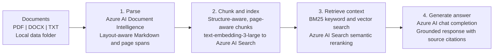

# Enterprise Advanced RAG Pipeline

A code-first **Retrieval-Augmented Generation (RAG)** sample using Azure AI Document Intelligence, Azure AI inference endpoints, and Azure AI Search. It demonstrates page-aware document chunking, embedding generation, hybrid keyword and vector retrieval, semantic ranking, and grounded response generation with source citations.

---

##  Core Architecture Overview

The pipeline processes PDFs, DOCX, and TXT files placed in the local `data/` folder.



**Optional evaluation:** `tests/test_evaluation.py` checks groundedness and relevance against live Azure services; it is separate from the normal query flow.


##  Key Enterprise Features

* **Layout-aware extraction:** Uses Azure AI Document Intelligence's `prebuilt-layout` model and page spans to preserve source page numbers.
* **Hybrid retrieval:** Combines BM25 keyword search, dense vectors, and Azure AI Search semantic ranking.
* **Keyless authentication:** Uses `DefaultAzureCredential` for Azure service access; no service keys are stored in the code.
* **Grounded responses:** Instructs the model to answer from retrieved context, cite context fragments, and refuse when no context is found.
* **Optional live evaluation:** `tests/test_evaluation.py` measures groundedness and relevance against live Azure services. It is not run as part of the normal query flow.

---

##  Repository Structure

```text
├── docs/
│   ├── SRS.md
│   └── architecture.md
├── src/
│   ├── index_documents.py     # Parse, chunk, embed, and upload local documents
│   ├── query_pipeline.py      # Interactive or --query command-line interface
│   ├── inference.py           # Azure AI embeddings and chat completion calls
│   ├── project_client.py      # Azure AI Foundry project client helper
│   ├── ingestion/parser.py    # Document Intelligence and page-aware chunking
│   ├── indexing/create_index.py
│   ├── retrieval/search.py
│   └── generation/orchestrator.py
├── tests/
│   ├── test_inference.py
│   ├── test_parser.py
│   ├── test_query_pipeline.py
│   └── test_evaluation.py     # Optional live Azure evaluation
├── data/.gitkeep              # Empty local document folder; documents are ignored
├── .env.example
├── .gitignore
└── README.md
```

---

##  Quick Start

### 1. Prerequisites
* Python 3.10 or higher
* Active Azure Subscription with an **Azure AI Foundry Project**
* Deployed models: `gpt-5-mini` and `text-embedding-3-large` (deployment names must match `.env`)
* Azure AI Document Intelligence endpoint
* Azure AI Search service; the Free tier works for small-scale testing, subject to its limits
* Azure CLI, signed in to the subscription used by `.env`
* Azure RBAC permissions for Document Intelligence, model inference, and Search. Index creation requires **Search Service Contributor**; document ingestion and querying require **Search Index Data Contributor** on the Search service.

### 2. Installation
```powershell
# Create and activate a virtual environment
python -m venv .venv
.\.venv\Scripts\Activate.ps1

# Install dependencies
python -m pip install -r requirements.txt
```

### 3. Environment Configuration
Copy the configuration template, then fill in the Azure endpoints, resource details, and model deployment names:
```powershell
Copy-Item .env.example .env
```

Sign in to Azure in the same terminal so `DefaultAzureCredential` can authenticate:
```powershell
az login
az account set --subscription "<your-subscription-id>"
```

### 4. Running the Pipeline
The repository includes an empty `data/` folder. Add documents you are authorized to process there; only the folder placeholder is tracked, while its contents are git-ignored. Ingestion sends those documents to Azure Document Intelligence, then uploads their chunks to Azure AI Search. Re-running ingestion replaces the indexed chunks for each successfully processed source file.
```powershell
# Create the search index schema
python src\indexing\create_index.py

# Parse documents and index their chunks
python src\index_documents.py --data-dir .\data

# Start an interactive question prompt
python src\query_pipeline.py

# Or pass a question directly
python src\query_pipeline.py --query "What are our cloud safety compliance parameters?"
```

Run the local tests without calling Azure:
```powershell
python -m pytest tests\test_parser.py tests\test_inference.py tests\test_query_pipeline.py -q
```

### 5. Document and GitHub safety
Do not commit confidential or third-party documents unless you have permission to redistribute them. `.gitignore` excludes the entire local `data/` folder. If you want demo content in the repository, use original synthetic examples or material whose license explicitly allows redistribution, and retain any required attribution or license notices. Ignoring files does not remove files that were already committed.

---

## Optional Live Evaluation

The live test in `tests/test_evaluation.py` requires configured Azure services and makes live model/evaluation calls. Run it explicitly:
```powershell
python -m pytest tests\test_evaluation.py -v -s
```

The GitHub Actions workflow runs the local tests on pushes and pull requests. Its live Azure evaluation step is skipped unless the repository has these secrets configured: `AZURE_CLIENT_ID`, `AZURE_TENANT_ID`, `AZURE_SUBSCRIPTION_ID`, `AZURE_PROJECT_ENDPOINT`, `AZURE_PROJECT_NAME`, `AZURE_RESOURCE_GROUP`, `AZURE_INFERENCE_ENDPOINT`, `AZURE_SEARCH_ENDPOINT`, and `AZURE_SEARCH_INDEX_NAME`. Configure an Azure federated credential for GitHub Actions and grant its identity the required Azure roles before enabling live evaluation.

| Metric | Target | Description | Evaluator |
| :--- | :--- | :--- | :--- |
| **Groundedness** | `>= 4.0 / 5` | Scores answer grounding against retrieved context. | Azure AI Evaluation SDK |
| **Relevance** | `>= 4.0 / 5` | Scores relevance to the user query. | Azure AI Evaluation SDK |